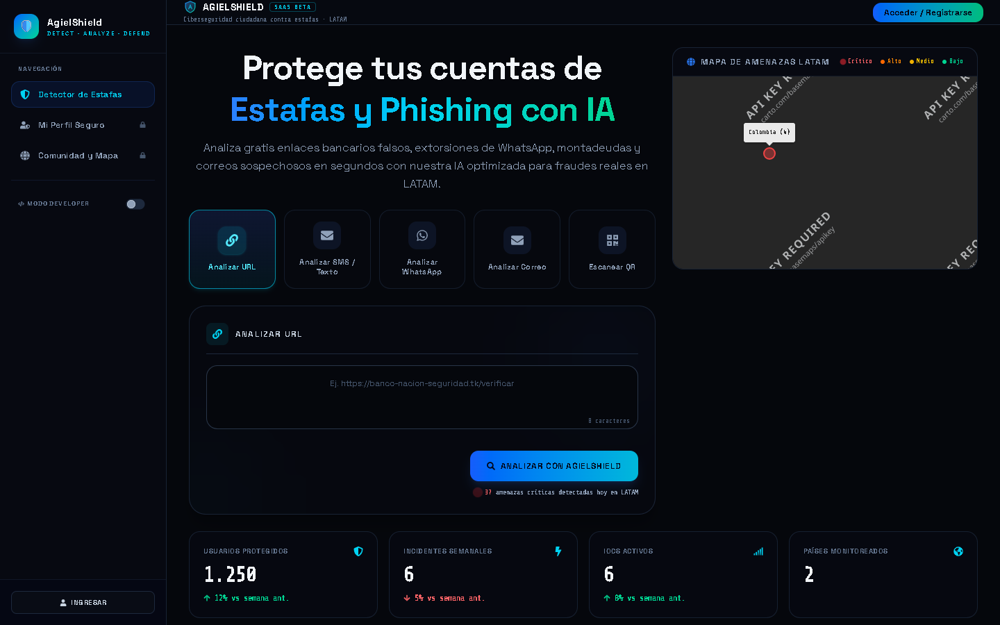
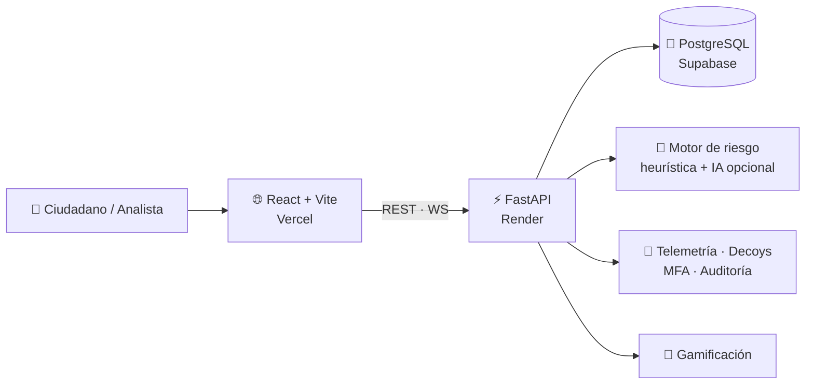
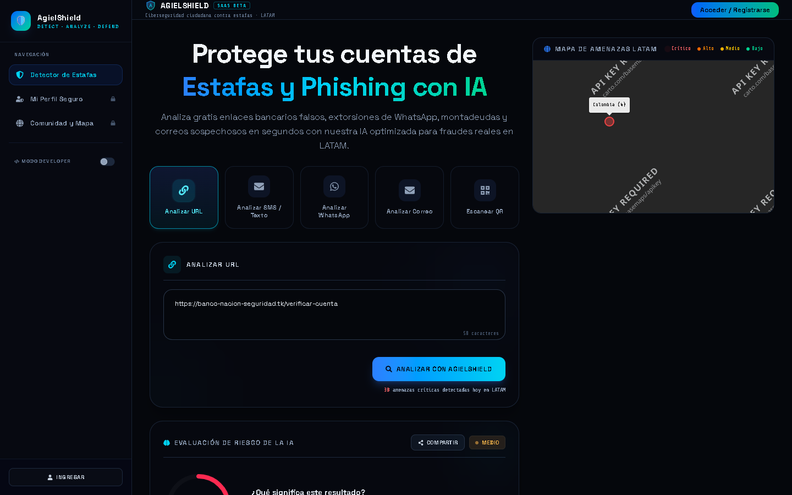
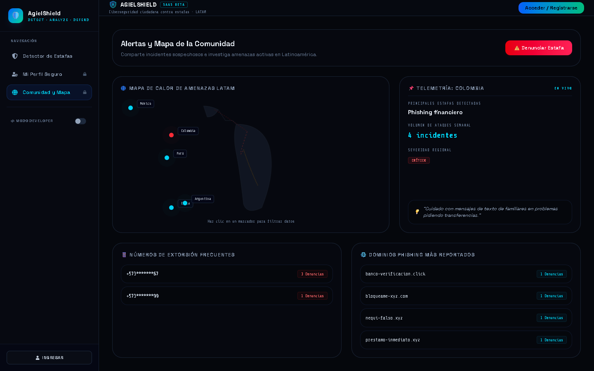
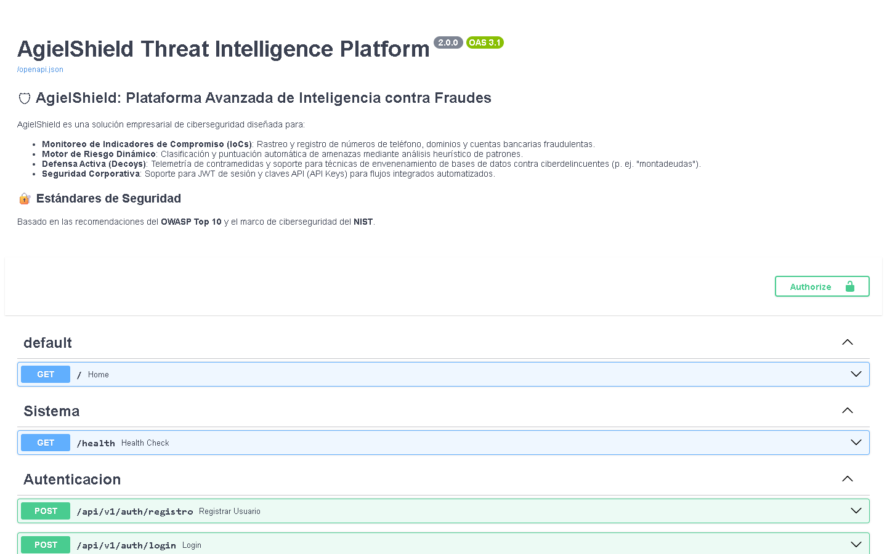
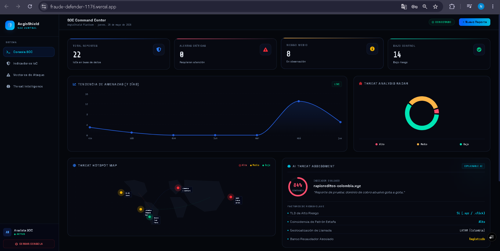
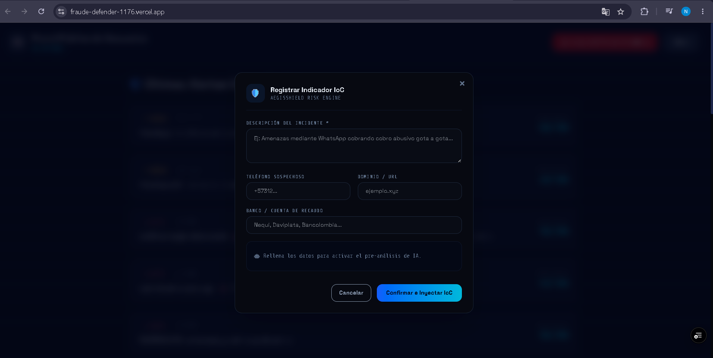

<div align="center">

# 🛡️ AgielShield — Anti-Fraud Intelligence Platform

### Ciberseguridad ciudadana contra phishing, extorsión y fraude financiero en LATAM

[](https://github.com/mazagir/fraude-defender/actions/workflows/ci.yml)
[](https://frontend-mazagirs-projects.vercel.app)
[](https://agishield-api.onrender.com/health)
[](https://agishield-api.onrender.com/docs)
[](https://frontend-mazagirs-projects.vercel.app)
[](backend/requirements.txt)

**🔴 En vivo:** [Abrir aplicación](https://frontend-mazagirs-projects.vercel.app) · [API docs](https://agishield-api.onrender.com/docs) · [Health check](https://agishield-api.onrender.com/health)

</div>

---

## 🎬 Demo

> Grabada contra el despliegue real: frontend en Vercel, API en Render y datos de inteligencia comunitaria.

[](https://raw.githubusercontent.com/mazagir/fraude-defender/main/docs/demo/agishield-demo.mp4)

<video src="https://raw.githubusercontent.com/mazagir/fraude-defender/main/docs/demo/agishield-demo.mp4" controls width="100%"></video>

[Ver guía completa de la demo →](docs/DEMO.md)

---

## ✨ ¿Qué hace AgielShield?

AgielShield es una plataforma de **threat intelligence** y análisis de fraude que combina un detector ciudadano con un panel SOC. Permite:

- **Analizar sospechas** — URLs/dominios, números de teléfono, cuentas bancarias y texto de mensajes o correos.
- **Clasificar riesgo** — motor heurístico con puntaje y niveles `LOW`, `MEDIUM`, `HIGH` y `CRITICAL`.
- **Correlacionar IoCs** — reportes de la comunidad, mapa LATAM y telemetría de incidentes.
- **Defensa activa** — registro de contramedidas y telemetría de *decoys* para envenenar bases de datos de estafadores.
- **Gamificación** — puntos, niveles y logros por reportes y análisis útiles.
- **Seguridad de acceso** — JWT, API keys, MFA con TOTP, roles y auditoría administrativa.
- **Tiempo real opcional** — WebSocket de telemetría para el centro de operaciones.

La IA (Gemini) es **opcional**: si no se configura `GEMINI_API_KEY`, la plataforma opera con el motor heurístico local.

---

## 🏗️ Arquitectura



| Capa | Tecnología | Entorno |
|---|---|---|
| Frontend | React 19 + TypeScript + Vite + Tailwind | Vercel |
| Backend | FastAPI + SQLAlchemy + Pydantic + SlowAPI | Render (Docker) |
| Base de datos | PostgreSQL (Supabase) / SQLite local | Supabase / local |
| Seguridad | JWT, bcrypt, TOTP, API keys, CORS, headers HTTP | Backend |
| CI/CD | GitHub Actions → lint, tests, build y deploy | GitHub |
| Tiempo real | WebSocket `/api/v1/ws/telemetry` | Backend |

---

## 🚀 Inicio rápido

### Opción 1 — Verlo desplegado

No necesitas instalar nada:

- **App:** <https://frontend-mazagirs-projects.vercel.app>
- **API:** <https://agishield-api.onrender.com/docs>
- **Salud:** <https://agishield-api.onrender.com/health>

> En el plan gratuito de Render, la API puede tardar ~30–60 s en responder si estuvo inactiva.

### Opción 2 — Demo local interactiva (recomendado)

Un solo comando desde la raíz del repositorio:

```bash
git clone https://github.com/mazagir/fraude-defender.git
cd fraude-defender
npm run demo
```

Ese comando hace todo automáticamente:

- crea `backend/.venv` si hace falta;
- instala dependencias de backend y frontend;
- genera una clave JWT efímera (no se guarda ni se muestra);
- siembra 50 incidentes ficticios en SQLite;
- arranca la API en `http://localhost:8000`;
- arranca y abre la UI en `http://localhost:5173`.

Detén todo con `Ctrl+C`. Más detalles en [docs/DEMO.md](docs/DEMO.md).

### Opción 3 — Instalación manual

#### Requisitos

- Node.js **20+**
- Python **3.11+** (CI usa 3.13)
- Git

#### 1. Backend

```bash
cd backend
python -m venv .venv
```

Windows:

```powershell
.\.venv\Scripts\activate
pip install -r requirements.txt
copy .env.template .env
```

macOS / Linux:

```bash
source .venv/bin/activate
pip install -r requirements.txt
cp .env.template .env
```

Edita `backend/.env` y define al menos:

```dotenv
ENVIRONMENT=development
DB_PROVIDER=sqlite
JWT_SECRET_KEY=cambia-esta-clave-por-una-larga-y-aleatoria
```

Siembra datos de ejemplo y arranca la API:

```bash
python tools/seed_demo.py --dry-run
python tools/seed_demo.py
uvicorn app.main:app --reload --port 8000
```

Comprueba:

```bash
curl http://localhost:8000/health
```

#### 2. Frontend

En otra terminal:

```bash
cd frontend
npm ci
cp .env.example .env     # Windows: copy .env.example .env
```

Ajusta `frontend/.env`:

```dotenv
VITE_API_URL=http://localhost:8000
```

Arranca:

```bash
npm run dev
```

Abre <http://localhost:5173>.

> El frontend ya detecta `localhost` y usa `http://localhost:8000` aunque no definas `VITE_API_URL`.

### Opción 4 — Docker

Necesitas `backend/.env` creado como en la opción 3.

```bash
docker compose up --build
```

- Frontend: <http://localhost:5173>
- API: <http://localhost:8000/docs>

---

## 🔐 Variables de entorno

Nunca versiones archivos `.env`. Usa las plantillas `backend/.env.template` y `frontend/.env.example`.

| Variable | Local | Producción | Uso |
|---|---|---|---|
| `JWT_SECRET_KEY` | Obligatoria | Obligatoria | Firma de tokens JWT |
| `ENVIRONMENT` | `development` | `production` | Activa verificaciones de seguridad |
| `DB_PROVIDER` | `sqlite` | `supabase` | Selecciona el proveedor de base de datos |
| `DATABASE_URL` | Opcional | Según proveedor | URL SQLAlchemy directa |
| `SUPABASE_DATABASE_URL` | — | Obligatoria | URL de PostgreSQL administrado |
| `NEON_DATABASE_URL` | Opcional | Opcional | Proveedor alternativo |
| `ALLOWED_API_KEYS` | Opcional | Obligatoria | Claves B2A separadas por coma |
| `GEMINI_API_KEY` | Opcional | Opcional | Habilita análisis con IA |
| `WS_AUTH_REQUIRED` | Opcional | Recomendado `true` | Exige token en WebSocket |
| `BACKEND_CORS_ORIGINS` | Opcional | Obligatoria | Orígenes permitidos |
| `CORS_ALLOW_ORIGIN_REGEX` | Opcional | Recomendado | Orígenes con patrón (Vercel/Render) |
| `ADMIN_USER` | Opcional | Obligatoria | Usuario base del `SUPER_ADMIN` |
| `ADMIN_PASSWORD_HASH` | Opcional | Obligatoria | Hash bcrypt del administrador |
| `TWILIO_AUTH_TOKEN`, `EMAIL_*` | Opcional | Opcional | Notificaciones y correo |
| `VITE_API_URL` | `http://localhost:8000` | URL de Render | Base de la API en el frontend |

No existe contraseña de administrador por defecto. Si no defines `ADMIN_PASSWORD_HASH` o `ADMIN_PASSWORD_RAW`, no se siembra el `SUPER_ADMIN`. El demo local no necesita credenciales administrativas.

---

## 🧪 Pruebas

Backend:

```bash
cd backend
python -m pytest -q
```

Frontend:

```bash
cd frontend
npm ci
npm run lint
npm test -- --run
npx tsc --noEmit
npm run build
```

CI ejecuta lint, tests y build en cada push/PR a `main`, y despliega cuando el push es a `main`.

---

## 📡 API

Documentación interactiva:

- Local: <http://localhost:8000/docs>
- Producción: <https://agishield-api.onrender.com/docs>
- Esquema: <https://agishield-api.onrender.com/openapi.json>

### Endpoints públicos principales

| Método | Ruta | Descripción |
|---|---|---|
| `GET` | `/health` | Estado del servicio y proveedor de BD |
| `POST` | `/api/v1/auth/registro` | Registro de usuario |
| `POST` | `/api/v1/auth/login` | Login con JWT |
| `POST` | `/api/v1/reportes/analizar` | Analizar URL, teléfono, cuenta o texto |
| `POST` | `/api/v1/reportes/publico` | Crear reporte anónimo |
| `GET` | `/api/v1/reportes/publico/listar` | Listar reportes públicos |
| `GET` | `/api/v1/threat-intel` | KPIs, países y eventos recientes |
| `GET` | `/api/v1/admin/leaderboard` | Ranking público |
| `POST` | `/api/v1/webhooks/whatsapp` | Ingesta de reportes por WhatsApp |
| `GET` | `/docs` · `/openapi.json` | Swagger UI y contrato OpenAPI |

### Endpoints autenticados

| Método | Ruta | Descripción |
|---|---|---|
| `GET` | `/api/v1/auth/me` | Perfil actual |
| `GET` | `/api/v1/scan-history` | Historial de análisis |
| `POST` | `/api/v1/scan-history` | Guardar análisis |
| `GET` · `PUT` | `/api/v1/gamification` | Puntos y preferencias |
| `GET` · `DELETE` | `/api/v1/reportes` | Reportes privados |
| `WS` | `/api/v1/ws/telemetry` | Telemetría en tiempo real |

Las rutas `/api/v1/admin/*` (excepto `leaderboard`) requieren rol `super_admin`.

Límite global: **200 peticiones/minuto por IP**, con límites más estrictos en login, registro, análisis y reportes públicos.

---

## 🖥️ Vistas de la aplicación

| Vista | Qué muestra |
|---|---|
| **Detector de Estafas** | Análisis de enlaces y mensajes con puntaje, señales y recomendaciones |
| **Mi Perfil Seguro** | Historial, gamificación, logros y configuración MFA |
| **Comunidad y Mapa** | Reportes, mapa LATAM y telemetría de incidentes |
| **Consola SOC (CTO)** | Modo desarrollador con telemetría avanzada |
| **Panel de Administración** | Usuarios, reportes, auditoría y métricas (solo `super_admin`) |

### Capturas del despliegue

| Home | Detector | Comunidad |
|---|---|---|
|  |  |  |

| API docs | SOC | Portal público |
|---|---|---|
|  |  |  |

---

## 📦 Estructura del repositorio

```text
.
├── backend/
│   ├── app/
│   │   ├── api/v1/endpoints/    # auth, reportes, admin, telemetría, webhooks...
│   │   ├── core/                # configuración, seguridad, base de datos
│   │   ├── models/              # modelos SQLAlchemy
│   │   └── services/            # motor de riesgo, IA, defensa
│   ├── tests/                   # suite pytest
│   ├── tools/                   # seed_demo, verify_db, migraciones
│   ├── requirements.txt
│   └── Dockerfile
├── frontend/
│   ├── src/components/          # UI, SOC, admin, perfil, mapa
│   ├── src/hooks/               # lógica de aplicación y telemetría
│   ├── src/views/               # pantallas principales
│   ├── package.json
│   └── vercel.json
├── scripts/                     # demo, validación y generación documental
├── docs/
│   ├── DEMO.md                  # guía de demo
│   ├── demo/                    # video real
│   ├── screenshots/             # capturas del despliegue
│   └── informes y póster
├── .github/workflows/ci.yml
├── docker-compose.yml
├── render.yaml
└── package.json                 # npm run demo
```

---

## 🚢 Despliegue

| Componente | Plataforma | Configuración |
|---|---|---|
| Frontend | Vercel | `frontend/vercel.json`, `rootDirectory=frontend` |
| Backend | Render | `render.yaml`, `backend/Dockerfile`, healthcheck `/health` |
| Base de datos | Supabase | `DB_PROVIDER=supabase` + `SUPABASE_DATABASE_URL` |
| CI/CD | GitHub Actions | `.github/workflows/ci.yml` |

El deploy se dispara automáticamente al hacer push a `main`, siempre que los secretos `VERCEL_TOKEN`, `VERCEL_ORG_ID`, `VERCEL_PROJECT_ID`, `RENDER_SERVICE_ID` y `RENDER_API_KEY` estén configurados en el repositorio.

---

## 🛟 Solución de problemas

| Síntoma | Causa probable | Solución |
|---|---|---|
| `FATAL: Required environment variable 'JWT_SECRET_KEY'` | Falta la clave JWT | Define `JWT_SECRET_KEY` o usa `npm run demo` |
| API responde 503 al primer intento | Render frío | Espera 30–60 s y vuelve a intentar |
| Error CORS en local | URL base incorrecta | Verifica `VITE_API_URL=http://localhost:8000` |
| El puerto 8000 está ocupado | Otro proceso escuchando | Detén ese proceso o usa `npm run demo` para reutilizarlo si es AgielShield |
| El mapa no muestra incidentes | Base sin sembrar | Ejecuta `python tools/seed_demo.py --force` |
| No aparece el panel admin | No hay `SUPER_ADMIN` | Configura `ADMIN_USER` y `ADMIN_PASSWORD_HASH` en el entorno |
| `python` no encontrado | Python fuera del PATH | Usa `python3` en macOS/Linux o `py -3` en Windows |

---

## 🎓 Proyecto académico

**Programa:** Tecnología en Desarrollo de Sistemas de Información y Software

**Integrantes:**

- Neil David Maza Girado
- Steven Ruiz Fontalvo
- Keider Polo Arteaga

**Asesora:** Maybelline Castro

Documentos disponibles en [`docs/`](docs):

- [Demo y capturas](docs/DEMO.md)
- [Póster con datos reales](docs/Poster_AgielShield_DATOS_REALES.pdf)
- [Informe Final 115](docs/Informe_Final_AgielShield_115_DILIGENCIADO.docx)
- [Proyecto 111 corregido](docs/Proyecto_Grado_AgielShield_111_CORREGIDO.docx)

---

<div align="center">

**Detect · Analyze · Defend**

[⬆ Volver arriba](#-agielshield--anti-fraud-intelligence-platform)

</div>
