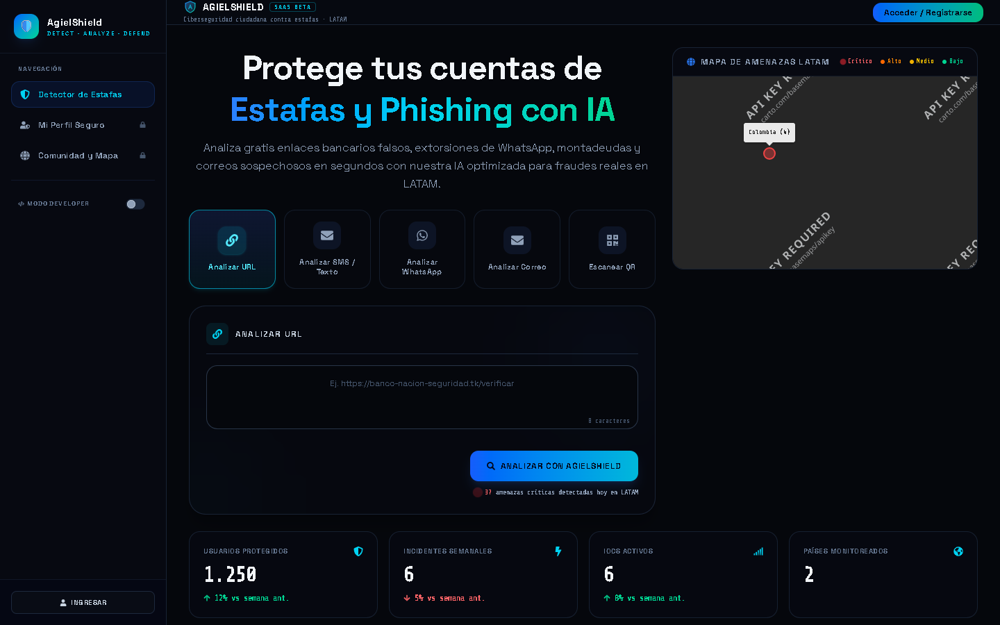
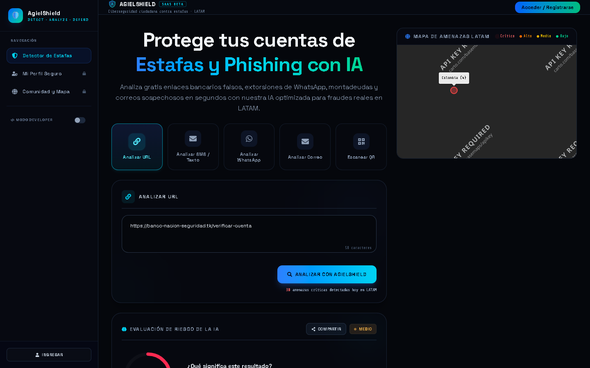
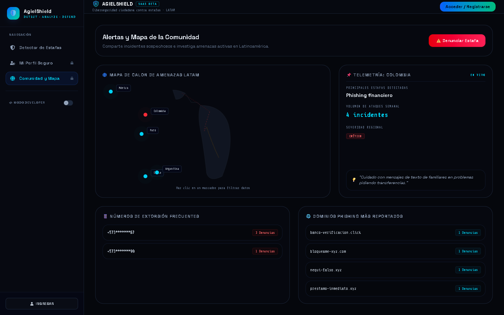
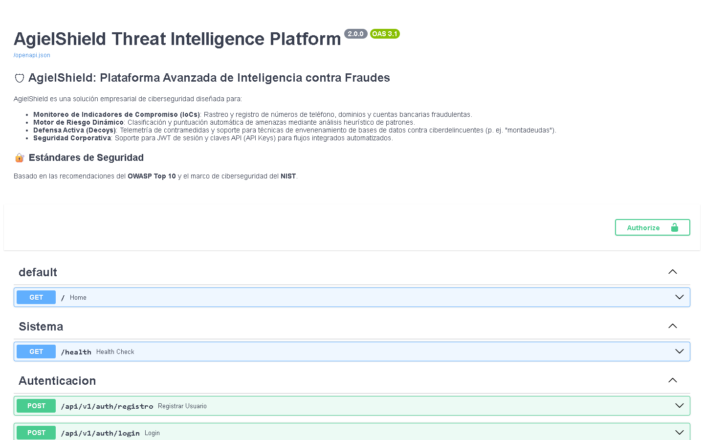

# 🎬 Demo de AgielShield

Hay dos formas de ver la plataforma: **en vivo** (desplegada) o **interactiva local** (con datos de ejemplo).

## 1. Demo en vivo

- Frontend: <https://frontend-mazagirs-projects.vercel.app>
- API: <https://agishield-api.onrender.com/docs>
- Health check: <https://agishield-api.onrender.com/health>

> Render puede tardar unos segundos en despertar si el plan gratuito ha estado inactivo.

### Video real (37 s)

El recorrido muestra el frontend en Vercel, el análisis de una URL de phishing, el mapa comunitario y la API en Render.

[](https://raw.githubusercontent.com/mazagir/fraude-defender/main/docs/demo/agishield-demo.mp4)

<video src="https://raw.githubusercontent.com/mazagir/fraude-defender/main/docs/demo/agishield-demo.mp4" controls width="100%"></video>

## 2. Demo interactiva local

Desde la raíz del repositorio:

```bash
npm run demo
```

Ese único comando:

1. Crea `backend/.venv` si no existe.
2. Instala dependencias de backend y frontend si faltan.
3. Genera una clave JWT **efímera** (no se guarda ni se imprime).
4. Siembra 50 incidentes ficticios en SQLite.
5. Arranca la API en `http://localhost:8000`.
6. Arranca la UI en `http://localhost:5173` y la abre en el navegador.

Para detener todo:

```text
Ctrl+C
```

Opciones útiles:

```bash
npm run demo -- --no-open      # no abre el navegador
npm run demo -- --seed-only    # solo siembra datos
npm run demo -- --force-seed   # inserta datos aunque ya existan
npm run demo -- --no-install   # omite instalación de dependencias
```

## 3. Recorrido guiado

### A. Detector de estafas

1. En el menú lateral entra a **Detector de Estafas**.
2. Pega este ejemplo ficticio:

   ```text
   https://banco-nacion-seguridad.tk/verificar-cuenta
   ```

3. Pulsa **Analizar con AgielShield**.
4. Observa el puntaje de riesgo, los indicadores y las recomendaciones.

### B. Comunidad y mapa

1. Entra a **Comunidad y Mapa**.
2. Verás los 50 incidentes sembrados, distribuidos en LATAM.
3. El panel de telemetría muestra KPIs y eventos recientes.

### C. Perfil, historial y gamificación

1. Pulsa **Acceder / Registrarse**.
2. Crea una cuenta con correo de prueba.
3. Entra a **Mi Perfil Seguro** para ver historial, logros y puntos.

### D. API

Abre <http://localhost:8000/docs> y prueba:

```text
GET /health
GET /api/v1/threat-intel?limit=5
POST /api/v1/reportes/analizar
```

## 4. Capturas del despliegue

| Vista | Captura |
|---|---|
| Home en Vercel |  |
| Análisis de phishing |  |
| Comunidad y mapa |  |
| API docs en Render |  |

## 5. Seguridad

- El demo local usa SQLite, datos ficticios y una clave JWT generada en memoria.
- No hay contraseñas ni tokens en el repositorio.
- No ejecutes los scripts de `scripts/` que apuntan a producción salvo que sepas qué hacen.
